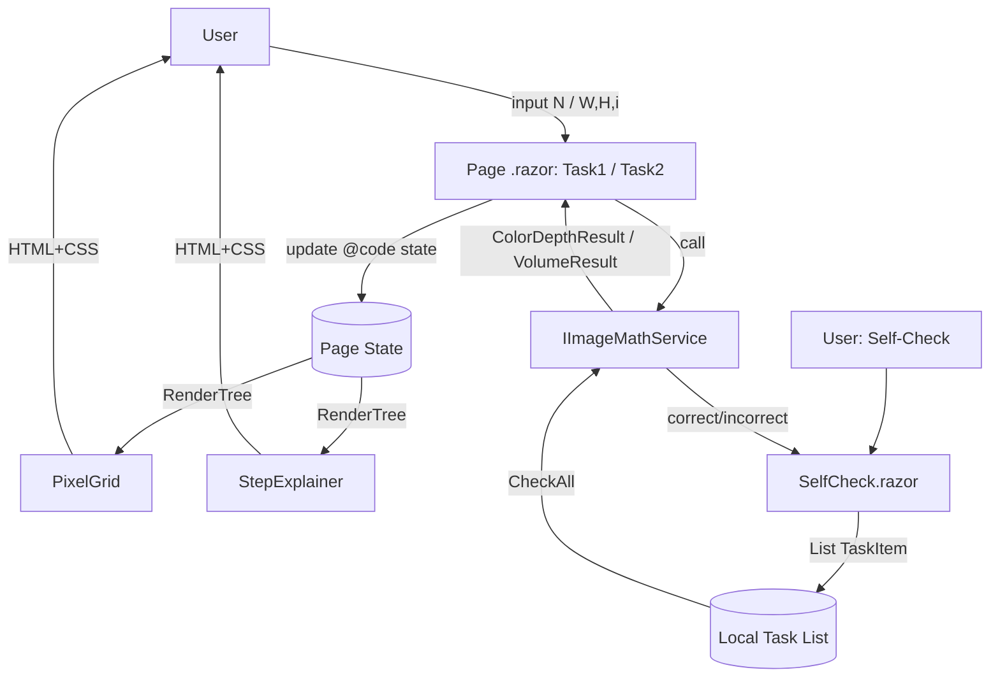

# PixelAnatomy

An educational web application on the topic **"Raster Image: Color Depth and Size"**.
Individual Computer Science project.

The application explains two tasks:
1. How to determine the color depth **i** (bits per pixel) from the number of colors in the palette **N**.
2. How to calculate the image size **V** in bits, bytes, and kilobytes from the dimensions **W × H** and color depth **i**.

---

## 1. Tools and Versions

| Tool | Version | Purpose |
|---|---|---|
| .NET SDK | 10.0 | Runtime and build environment |
| Blazor Web App (Interactive Server) on .NET | 10.0 | UI framework and web host in C# |
| Visual Studio 2026 (18.10.3) | – | Development environment (IDE) |
| Browser | Chrome (latest version) | Running and testing |
| Mermaid Live | https://mermaid.live | Diagram in README |

---

## 2. Running the Application

### Locally from Visual Studio
1. Open `PixelAnatomy.sln`.
2. Install the **ASP.NET and web development** workload in Visual Studio Installer if it is not installed.
3. Press `F5` (or `Ctrl+F5` without debugging).
4. Open the URL from the console `https://localhost:xxxx` in your browser.

### Locally from Terminal
```powershell
cd PixelAnatomy
dotnet restore
dotnet build
dotnet run
```

The application will open at the address printed in the console.

---

## 3. Limitations

- Works **without** image compression, **without headers**, and without metadata.
- Real images are neither uploaded nor saved – only numerical parameters are used.
- Color depth **i** is restricted to the range 1..48 bits, dimensions W and H – 1..100000 pixels.
- Number of palette colors **N** – 2..16,777,216 (2²⁴).
- Input – integers only. Leading zeros (`040`) are forbidden; decimals and text are not accepted.
- Pixel grid visualization is a schematic model: if a side is greater than 12, 12 is shown (with a label indicating the actual size).

---

## 4. Architecture

### 4.1. Application Parts

| Part | Folder / Files | Responsibility |
|---|---|---|
| **Entry Point** | `Program.cs` | Creates the web host, registers services (`IImageMathService`), connects Razor Components and Interactive Server. |
| **Root HTML** | `Components/App.razor` | Page skeleton: `<head>`, CSS links, Blazor script connection. |
| **Routing** | `Components/Routes.razor` | Reads the URL and decides which page from `Pages/` to display. |
| **Layout** | `Components/Layout/MainLayout.razor`, `NavMenu.razor` | Appearance: sidebar menu, main content area. |
| **Pages** | `Components/Pages/*.razor` | Screens: Home, Task 1, Task 2, Self-Check Tasks, Error, NotFound. |
| **Reusable Components** | `Components/PixelGrid.razor`, `Components/StepExplainer.razor` | Pixel grid visualization and step-by-step explanation cards. |
| **Models** | `Models/*.cs` | Data: `PaletteParameters`, `ImageParameters`, `ColorDepthResult`, `VolumeResult`. |
| **Services** | `Services/IImageMathService.cs`, `Services/ImageMathService.cs` | Pure calculations: color depth by N and image size by W, H, i. |
| **Styles** | `wwwroot/app.css` | Minimalist styling, consistent color semantics. |

### 4.2. Where Calculations Run and State is Stored

- **Calculations** – strictly in `Services/ImageMathService.cs`. It is **stateless**: each operation takes input numbers and returns a `record` result (`ColorDepthResult` or `VolumeResult`).
- **State** – lives in the `@code` blocks of the pages (`_palette`, `_img`, `_result`, `_step`, `_answer1`, `_tasks`, etc.). This is intentional: state is tied to a specific page rather than a service and does not persist across browser reloads.
- **The "Data Change → Reset Explanation" rule** is implemented in `Recompute(...)`: when input data changes, all steps, answers, and highlights are reset.

### 4.3. Interaction Flow



### 4.4. Path of a Single User Action

Example: the user opens `/task2`, enters `1920`, `1080`, `24`, and clicks "Apply".

1. **`@oninput`** on `<input>` triggers `OnWInput` / `OnHInput` / `OnIInput`. Each saves the string to `_wInput` / `_hInput` / `_iInput` and calls `TryParseAll`.
2. `TryParseAll` checks: not empty, no leading zero, parses as `int`, within range. If any condition fails – `_canApply = false`, the "Apply" button stays disabled, and an error message appears below.
3. Clicking "Apply" invokes `Apply → Recompute(w, h, i)`.
4. `Recompute` builds `ImageParameters`, calls `MathService.ComputeVolume(w, h, i)`, stores `VolumeResult`, and resets steps and answers.
5. Blazor re-renders the page: `<PixelGrid>` and numerical badges update.
6. If the user answers Question 1 incorrectly – three `<StepExplainer>` components render below the question showing the full step-by-step solution for the **current** numbers.

### 4.5. Why It Is Organized This Way

- **Models and service are separated from UI** – they can be tested in a console app or via unit tests without Blazor. This meets the specification requirement: "separate calculations from presentation".
- **Pages store state** – easier to explain during the project defense: "here are the variables, they update on events".
- **Reusable components** (`PixelGrid`, `StepExplainer`) do not know where the data comes from: they only receive parameters. This makes the visualization universal.
- **Exact arithmetic**: `long` for pixels and bits, `double` – only for derived units (bytes, KB). Integer validation with leading-zero checks uses `long.TryParse` without floating-point arithmetic.

---

## 5. Technology Justification

**Language: C#. Framework: Blazor Web App (Interactive Server), .NET 10.**

C# is a strongly typed language. This directly aligns with the project requirement: the model, calculations, and answer verification are implemented in a statically typed language where the compiler catches errors before runtime.

---

## 6. Sources

- School Computer Science curriculum, topic "Information Encoding and Measurement": formulas N = 2^i, i = ⌈log₂ N⌉, V = W×H×i.
- Microsoft Learn Documentation:
  - "Blazor Web App" – https://microsoft.com
  - "Razor components" – https://microsoft.comcomponents/
- Mermaid Documentation: https://js.org

---

## 7. Note on AI Usage

I chose the technology stack (C#, Blazor Web App, Interactive Server) independently based on the project requirements: a strongly typed language + a web technology built on top of it. The solution relies on official Microsoft documentation and Computer Science educational materials.

An AI assistant was used at the following stages:

1. **Architecture design.** Discussed how to separate responsibilities across layers. The final separation into `Models / Services / Components / Pages` was a conscious choice: `ImageMathService` was made stateless, while pages store state locally.
2. **Code development.** AI assisted with `.razor` templates and common Razor errors (such as RZ9986 – nested quotes in component attributes). Every suggestion was verified using `dotnet build` and manual testing.
3. **Debugging.** AI pointed out that using `@oninput="..."` with a string literal in quotes is invalid.

**What AI suggested that I rejected:** the idea of using `double` fields for W/H (fractional pixels). That makes no sense – kept them as `int`.

**How I verified AI output:** every suggestion → `dotnet build` → running the app → manual verification against test numbers (see Section 8).

---

## 8. Test Cases (Expected / Actual)

Five scenarios covering standard data, edge cases, invalid input, parameter changes, and application restart.

### Test 1. Standard Data
**Steps:** `/task2`, enter W = 1920, H = 1080, i = 24, click "Apply".
**Expected:** P = 2,073,600, V_bits = 49,766,400, V_bytes = 6,220,800, V_KB ≈ 6075, V_MB ≈ 5.93. Grid – schematic 12×12 model.
**Actual:** Matches. A schematic palette is displayed (i = 24 → 2^24 colors, 64 shown).

### Test 2. Edge Case – Power of Two vs. Non-Power of Two
**Steps:** `/task1`, N = 8 → click "Apply". Then N = 100 → "Apply".
**Expected:** N = 8 → i = 3 bits; N = 100 → i = 7 bits (rounded up).
**Actual:** Matches; the explanation for N = 100 displays "2^6 = 64 < 100 ≤ 128 = 2^7".

### Test 3. Invalid Input
**Steps:** `/task1`, enter `040` in field N.
**Expected:** The message "Number must not start with zero" appears, and the "Apply" button is disabled.
**Actual:** Matches. Same behavior for `0`, empty field, decimals, and text.

### Test 4. Changing Parameters
**Steps:** `/task2`, apply 16×16, i = 4. Then change W to 10, H to 11, i to 8, and apply again.
**Expected:** Previous explanation, answers, and highlights reset; P = 110, V_bits = 880; the grid is drawn at actual size 10×11 (not schematic) because both sides are ≤ 12.
**Actual:** Matches.

### Test 5. Application Restart
**Steps:** Stop the application (Shift+F5). Start it again. Open `/selfcheck`.
**Expected:** State resets – all fields are empty, and the grade is not shown until "Check All" is clicked.
**Actual:** Matches (state lives in the server process memory).

---

## 9. Peer Testing

**Date:** 16.10.2026

**Task:** navigate the application without verbal hints, explain the key step, and solve one of the self-check problems.

**Tester notes:**
- Able to open the website: yes
- Understood where to enter data: yes
- Figured out the "Next / Back" steps: yes

## 10. Project Structure

```
PixelAnatomy/
├── Program.cs                     // Service registration, app startup
├── PixelAnatomy.csproj            // net10.0, ImplicitUsings, Nullable
├── README.md                      // This file
├── Components/
│   ├── App.razor                  // Root HTML
│   ├── Routes.razor               // Router
│   ├── _Imports.razor             // Global @using directives
│   ├── Layout/
│   │   ├── MainLayout.razor
│   │   └── NavMenu.razor
│   ├── Pages/
│   │   ├── Home.razor             // Landing page: title, instructions, author
│   │   ├── Task1Palette.razor     // /task1 – color depth
│   │   ├── Task2Volume.razor      // /task2 – image size
│   │   ├── SelfCheck.razor        // /selfcheck – 7 tasks + grading
│   │   ├── Error.razor
│   │   └── NotFound.razor
│   ├── PixelGrid.razor            // Pixel grid visualization
│   └── StepExplainer.razor        // Single explanation step card
├── Models/
│   ├── PaletteParameters.cs
│   ├── ImageParameters.cs
│   ├── ColorDepthResult.cs
│   └── VolumeResult.cs
├── Services/
│   ├── IImageMathService.cs
│   └── ImageMathService.cs        // All calculations live here
└── wwwroot/
    └── app.css                    // Styling
```
