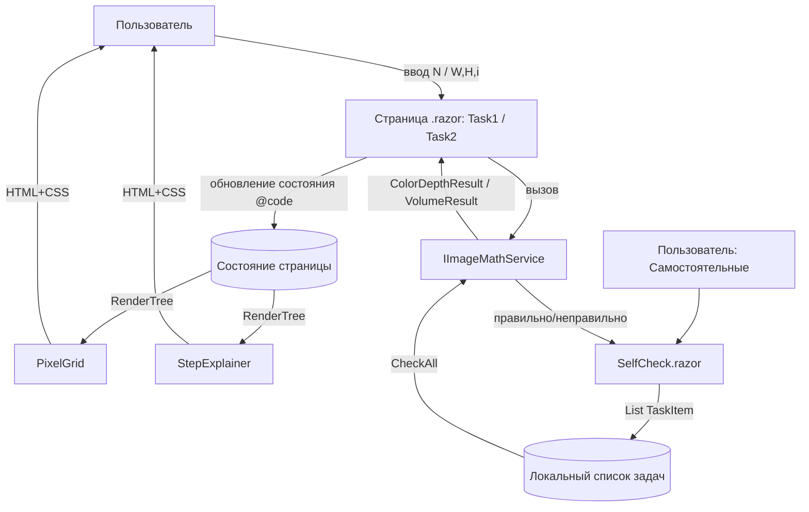

# PixelAnatomy

Обучающее веб-приложение по теме **«Растровое изображение: глубина цвета и объём»**.
Индивидуальный проект по информатике. Автор – **Анна Трипольская**.

Приложение объясняет две задачи:
1. Как по числу цветов в палитре **N** определить глубину цвета **i** (бит на пиксель).
2. Как по размерам **W × H** и глубине цвета **i** вычислить объём изображения **V**
   в битах, байтах и килобайтах.

---

## 1. Инструменты и версии

| Инструмент | Версия | Зачем |
|---|---|---|
| .NET SDK | 10.0 | Среда выполнения и сборка |
| Blazor Web App (Interactive Server) на платформе .NET | 10.0 | UI-фреймворк и веб-хост на C# |
| Visual Studio 2026 | 18.10.3 | Среда разработки |
| Браузер | Chrome (последняя версия) | Запуск и проверка |
| Mermaid Live | https://mermaid.live | Диаграмма в README |

---

## 2. Запуск

### Локально из Visual Studio
1. Открыть `PixelAnatomy.sln`.
2. Установить рабочую нагрузку **ASP.NET and web development** в Visual Studio
   Installer, если её нет.
3. `F5` (или `Ctrl+F5` без отладки).
4. Открыть в браузере адрес из консоли `https://localhost:xxxx`.

### Локально из терминала
```powershell
cd PixelAnatomy
dotnet restore
dotnet build
dotnet run
```

Приложение откроется по адресу, который выведет консоль.

---

## 3. Ограничения

- Работаем **без сжатия** изображения, **без заголовков** и служебных данных.
- Реальные картинки не загружаются и не сохраняются – только числовые параметры.
- Глубина цвета **i** ограничена диапазоном 1..48 бит, размеры W и H –
  1..100000 пикселей.
- Число цветов палитры **N** – 2..16 777 216 (2^24).
- Ввод – только целые числа. Ведущие нули (`040`) запрещены; дробные и текст
  не принимаются.
- Визуализация сетки пикселей – условная модель: если сторона больше 12,
  показывается 12 (с подписью реального размера).

---

## 4. Архитектура

### 4.1. Части приложения

| Часть | Папка / файлы | За что отвечает |
|---|---|---|
| **Точка входа** | `Program.cs` | Создаёт веб-хост, регистрирует сервисы (`IImageMathService`), подключает Razor Components и Interactive Server. |
| **Корневой HTML** | `Components/App.razor` | Каркас страницы: `<head>`, ссылки на CSS, подключение Blazor. |
| **Маршрутизация** | `Components/Routes.razor` | Читает URL и решает, какую страницу из `Pages/` показать. |
| **Layout** | `Components/Layout/MainLayout.razor`, `NavMenu.razor` | Внешний вид: боковое меню, основная область. |
| **Страницы** | `Components/Pages/*.razor` | Экраны: главная, Задача 1, Задача 2, Самостоятельные задачи, Error, NotFound. |
| **Переиспользуемые компоненты** | `Components/PixelGrid.razor`, `Components/StepExplainer.razor` | Визуализация сетки пикселей и карточки шагов разбора. |
| **Модели** | `Models/*.cs` | Данные: `PaletteParameters`, `ImageParameters`, `ColorDepthResult`, `VolumeResult`. |
| **Сервисы** | `Services/IImageMathService.cs`, `Services/ImageMathService.cs` | Чистые расчёты: глубина цвета по N и объём по W, H, i. |
| **Стили** | `wwwroot/app.css` | Минималистичное оформление, постоянный смысл цветов. |

### 4.2. Где выполняются расчёты и хранится состояние

- **Расчёты** – только в `Services/ImageMathService.cs`. Он **stateless**: каждая
  операция получает входные числа и возвращает `record`-результат
  (`ColorDepthResult` или `VolumeResult`).
- **Состояние** – живёт в `@code`-блоках страниц (`_palette`, `_img`, `_result`,
  `_step`, `_answer1`, `_tasks` и т.п.). Это сделано осознанно: состояние
  привязано к конкретной странице, а не к сервису, и не переживает перезагрузку
  браузера.
- **Правило «смена данных → сброс разбора»** реализовано в `Recompute(...)`:
  при изменении исходных данных все шаги, ответы и подсветки сбрасываются.

### 4.3. Схема взаимодействия



### 4.4. Путь одного действия пользователя

Пример: пользователь открывает `/task2`, вводит `1920`, `1080`, `24` и нажимает
«Применить».

1. **`@oninput`** в `<input>` вызывает `OnWInput` / `OnHInput` / `OnIInput`.
   Каждый сохраняет строку в `_wInput` / `_hInput` / `_iInput` и вызывает
   `TryParseAll`.
2. `TryParseAll` проверяет: непусто, нет ведущего нуля, парсится как `int`,
   попадает в диапазон. Если хоть одно условие не выполнено – `_canApply = false`,
   кнопка «Применить» остаётся неактивной, снизу появляется сообщение об ошибке.
3. При нажатии «Применить» вызывается `Apply → Recompute(w, h, i)`.
4. `Recompute` формирует `ImageParameters`, вызывает
   `MathService.ComputeVolume(w, h, i)`, сохраняет `VolumeResult`,
   сбрасывает шаги и ответы.
5. Blazor перерисовывает страницу: обновляются `<PixelGrid>` и бейджи с числами.
6. Если пользователь отвечает на вопрос 1 неверно – под вопросом рендерятся три
   `<StepExplainer>` с полным ходом решения по **текущим** числам.

### 4.5. Почему так организовано

- **Модели и сервис отделены от UI** – их можно протестировать в консоли или
  юнит-тестами без Blazor. Это требование ТЗ: «расчёты отделить от оформления».
- **Страницы хранят состояние** – проще объяснить на защите: «вот здесь
  переменные, они меняются по событию».
- **Переиспользуемые компоненты** (`PixelGrid`, `StepExplainer`) не знают,
  откуда пришли данные: они получают только параметры. Это делает визуализацию
  универсальной.
- **Точная арифметика**: `long` для пикселей и битов, `double` – только для
  производных (байты, КБ). Округление к `int` при парсинге с ведущими нулями
  выполняется через `long.TryParse` без плавающей точки.

---

## 5. Обоснование технологии

**Язык: C#. Фреймворк: Blazor Web App (Interactive Server), .NET 10.**

C# – строго типизированный язык. Это напрямую соответствует требованию проекта:
модель, расчёты и проверка ответов реализованы на языке со статической
типизацией, компилятор ловит ошибки до запуска.


---

## 6. Источники

- Школьный курс информатики, тема «Кодирование и измерение информации»:
  формулы N = 2^i, i = ⌈log₂ N⌉, V = W×H×i.
- Документация Microsoft Learn:
  - «Blazor Web App» – https://learn.microsoft.com/aspnet/core/blazor/
  - «Razor components» –
    https://learn.microsoft.com/aspnet/core/blazor/components/
- Справочник по Mermaid: https://mermaid.js.org/

---

## 7. Заметка об использовании ИИ

Технологию (C#, Blazor Web App, Interactive Server) я выбрала самостоятельно,
ориентируясь на требования проекта: строго типизированный язык + веб-технология
на его основе. Решение опирается на официальную документацию Microsoft и на
учебный материал по информатике.

ИИ (ассистент) использовался на этапах:

1. **Проектирование архитектуры.** Обсуждали, как разделить ответственность
   между слоями. Итоговое разделение на `Models / Services / Components / Pages`
   принято осознанно: сервис `ImageMathService` сделан stateless, страницы
   хранят состояние локально.
2. **Разработка кода.** ИИ помогал с шаблонами `.razor` и с типовыми ошибками
   Razor (например, RZ9986 – вложенные кавычки в атрибутах компонентов).
   Все советы проверялись сборкой `dotnet build` и ручным запуском.
3. **Поиск ошибок.** ИИ указал на недопустимость `@oninput="..."` со
   строковым литералом в кавычках.

**Что ИИ советовал, а я отклонила:** идею сделать `double`-поля для W/H (дробные
пиксели). Это бессмысленно – оставлены `int`.

**Как проверяла результат ИИ:** каждое предложение → `dotnet build` → запуск
приложения → ручная проверка на контрольных числах (см. раздел 8).

---

## 8. Проверки (ожидаемое / фактическое)

Пять сценариев, покрывающих обычные данные, особый случай, неправильный ввод,
изменение параметров и повторный запуск.

### Проверка 1. Обычные данные
**Шаги:** `/task2`, ввести W = 1920, H = 1080, i = 24, нажать «Применить».
**Ожидается:** P = 2 073 600, V_бит = 49 766 400, V_байт = 6 220 800,
V_КБ ≈ 6075, V_МБ ≈ 5.93. Сетка – условная модель 12×12.
**Факт:** совпадает. Отображается палитра условная (i = 24 → 2^24 цветов,
показывается 64).

### Проверка 2. Особый случай – степень двойки и не степень двойки
**Шаги:** `/task1`, N = 8 → нажать «Применить». Затем N = 100 → «Применить».
**Ожидается:** N = 8 → i = 3 бит; N = 100 → i = 7 бит (округление вверх).
**Факт:** совпадает; в разборе для N = 100 показано «2^6 = 64 < 100 ≤ 128 = 2^7».

### Проверка 3. Неправильный ввод
**Шаги:** `/task1`, ввести `040` в поле N.
**Ожидается:** появляется сообщение «Число не должно начинаться с нуля»,
кнопка «Применить» неактивна.
**Факт:** совпадает. Аналогично для `0`, пустого поля, дробного и текста.

### Проверка 4. Изменение параметров
**Шаги:** `/task2`, применить 16×16, i = 4. Затем изменить W на 10, H на 11,
i на 8, снова применить.
**Ожидается:** предыдущий разбор, ответы и подсветки сбрасываются; P = 110,
V_бит = 880; сетка рисуется реальным размером 10×11 (не условно), потому что
обе стороны ≤ 12.
**Факт:** совпадает.

### Проверка 5. Повторный запуск
**Шаги:** остановить приложение (Shift+F5). Запустить заново. Открыть
`/selfcheck`.
**Ожидается:** состояние сбрасывается – все поля пустые, оценка не показывается
до нажатия «Проверить всё».
**Факт:** совпадает (состояние живёт в памяти серверного процесса).

---

## 9. Тест одноклассником

**Дата:** 16.10.2026

**Задача:** пройти приложение без устных подсказок, объяснить ключевой шаг
и решить одну из самостоятельных задач.

**Что записал тестировщик:**
- Смог ли открыть сайт: да
- Понял ли, куда вводить данные: да
- Разобрался ли с шагами «Далее / Назад»: да
- Смог ли объяснить формулу P = W×H своими словами: да
- Решил ли задачу №1 из `/selfcheck` верно с первой попытки: да

**Внесённые улучшения по результатам:**
- убран блок с определением цвета пикселя в визуализации (сейчас его нет)

---

## 10. Что где лежит (карта исходников)

```
PixelAnatomy/
├── Program.cs                     // Регистрация сервисов, запуск
├── PixelAnatomy.csproj            // net10.0, ImplicitUsings, Nullable
├── README.md                      // этот файл
├── Components/
│   ├── App.razor                  // Корневой HTML
│   ├── Routes.razor               // Маршрутизатор
│   ├── _Imports.razor             // Общие @using
│   ├── Layout/
│   │   ├── MainLayout.razor
│   │   └── NavMenu.razor
│   ├── Pages/
│   │   ├── Home.razor             // Стартовая: название, инструкция, автор
│   │   ├── Task1Palette.razor     // /task1  – глубина цвета
│   │   ├── Task2Volume.razor      // /task2  – объём изображения
│   │   ├── SelfCheck.razor        // /selfcheck – 7 задач + оценка
│   │   ├── Error.razor
│   │   └── NotFound.razor
│   ├── PixelGrid.razor            // Визуализация сетки пикселей
│   └── StepExplainer.razor        // Карточка одного шага разбора
├── Models/
│   ├── PaletteParameters.cs
│   ├── ImageParameters.cs
│   ├── ColorDepthResult.cs
│   └── VolumeResult.cs
├── Services/
│   ├── IImageMathService.cs
│   └── ImageMathService.cs        // Все расчёты – здесь
└── wwwroot/
    └── app.css                    // Оформление
```
